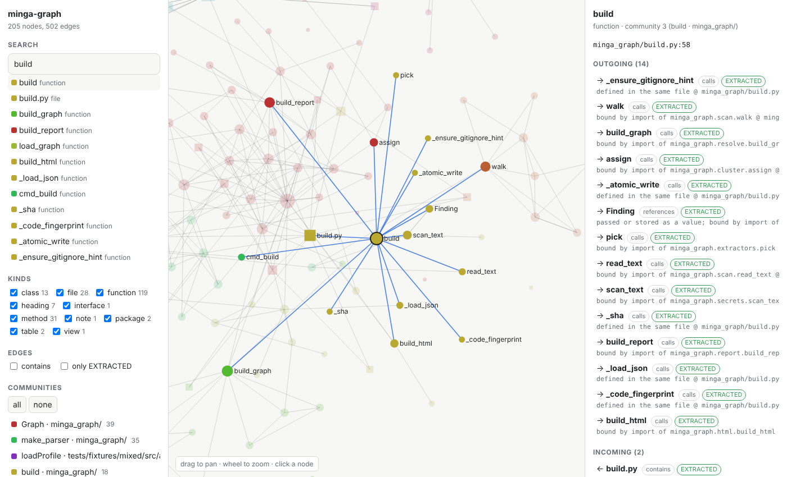

# minga-graph

Превращает кодовую базу (код, документацию, SQL-схемы, файлы зависимостей) в **локальный граф знаний**, по которому можно задавать вопросы вместо поиска grep'ом. Каждая связь объясняет, откуда она взялась, и указывает точное место `файл:строка`. Сделан для Claude Code, работает и из обычного терминала, и через MCP.

[English version →](README.md)



## Зачем ещё один

minga-graph вдохновлён идеей graphify, но написан с нуля и с другими приоритетами: **ничего не уходит с вашего компьютера и не выполняется ничего, что вы не контролируете.**

| | minga-graph |
|---|---|
| Зависимости | **нет** (только стандартная библиотека Python) |
| Доступ в сеть | **никогда**: без вызовов LLM, облака, CDN и проверок обновлений |
| Телеметрия и журналы запросов | **нет** |
| Доказательства связей | у каждой связи есть `EXTRACTED`/`INFERRED`, причина и `файл:строка` |
| Ошибочные связи | неоднозначные имена **не связываются вообще**, а не угадываются |
| Дополнительный анализ | влияние изменения, сравнение версий графа, циклические импорты, кандидаты в неиспользуемый код, поиск секретов |
| Вопросы | на английском **и на русском** (`minga-graph query "где проверяется токен"`) |
| Визуализация | один офлайн-файл `graph.html` со строгой Content-Security-Policy |

Честный компромисс: языков пока меньше (см. ниже). Новые языки в планах.

## Установка

Нужен Python 3.10+.

```bash
pipx install git+https://github.com/dmminga1983/minga-graph
minga-graph install          # добавляет навык /minga-graph в Claude Code (~/.claude/skills)
```

Дальше в Claude Code: `/minga-graph .`

Без установки: `python -m minga_graph build .` из клона репозитория.

## Использование

```bash
minga-graph build .                                # инкрементально: пересобираются только изменённые файлы
minga-graph query "как клиент добирается до таблицы пользователей"
minga-graph explain ApiClient
minga-graph path Profile formatUser
minga-graph impact formatUser                      # что сломается, если это изменить
minga-graph diff                                   # что изменилось в структуре с прошлой сборки
minga-graph cycles
minga-graph secrets .                              # код возврата 1, если найден секрет в коде
```

Результат в папке `minga-out/`:

```
graph.html        интерактивный граф, открывается офлайн в любом браузере
GRAPH_REPORT.md   ключевые узлы, подсистемы, неожиданные связи, циклы, неиспользуемое, секреты
graph.json        полный граф для скриптов и MCP-сервера
```

Пример:

```
$ minga-graph path Profile formatUser
Shortest path (4 hops):
  Profile --calls--> loadProfile --calls--> getUser --calls--> normalize --calls--> formatUser

Evidence:
  Profile --calls--> loadProfile [EXTRACTED] bound by import from ../api/client @ src/ui/Profile.jsx:6
  loadProfile --calls--> getUser [INFERRED] unique method name (receiver type unknown) @ src/api/client.ts:30
  getUser --calls--> normalize [EXTRACTED] this.normalize inside its class @ src/api/client.ts:14
  normalize --calls--> formatUser [EXTRACTED] bound by import from ../util/format @ src/api/client.ts:18
```

Коды возврата: `0` успех, `1` ошибка или найдены секреты, `3` неоднозначное имя (печатаются варианты), `4` не найдено.

## Что понимает

| Вход | Что становится узлами и связями |
|---|---|
| Python (`.py`, `.pyi`) | модули, классы, функции, методы, вложенные функции; импорты (в том числе относительные и внутри функций), вызовы, наследование, декораторы, функции, переданные как значения, комментарии `# NOTE/WHY/TODO/FIXME/HACK/SECURITY`. Разбор точным модулем `ast`. |
| JavaScript / TypeScript (`.js .jsx .ts .tsx .mjs .cjs`) | ES-импорты, `require`, реэкспорт, классы, интерфейсы, функции, стрелочные функции, методы (включая `#private`), `extends`/`implements`, вызовы, `this.x()` |
| SQL | таблицы, представления, внешние ключи (`REFERENCES`, `ALTER TABLE`), зависимости представлений |
| Markdown | дерево заголовков, ссылки на локальные файлы, упоминания `` `Символ` ``, связанные с кодом |
| Манифесты | зависимости из `package.json`, `pyproject.toml`, `requirements*.txt` |

По умолчанию пропускается: всё из `.gitignore` (включая вложенные), `.mingaignore`, `node_modules`, виртуальные окружения, артефакты сборки, lock-файлы и **все файлы `.env` (никогда не читаются)**.

## Достоверность связей

- `EXTRACTED`: имя явно связано в исходнике: определение в том же файле, привязка импорта, `self.x`/`this.x` внутри своего класса, SQL `REFERENCES`, ссылка в Markdown.
- `INFERRED`: совпадение по уникальному имени во всём проекте (например, метод вызывается у объекта неизвестного типа). Перед рискованным изменением откройте место `@ файл:строка`.
- Неоднозначные и слишком общие имена (`get`, `run`, `update`…) отбрасываются. Лучше без связи, чем с неверной.

## MCP-сервер

```bash
claude mcp add minga-graph -- minga-graph mcp /path/to/project
```

Инструменты: `graph_query`, `graph_explain`, `graph_path`, `graph_impact`, `graph_stats`. Только чтение, граф перечитывается после пересборки.

## Автообновление графа

```bash
minga-graph hook install      # git-хук post-commit, пересборка в фоне
```

## Параметры

`--lang ru` отчёт на русском · `--exclude ШАБЛОН` дополнительное правило исключения · `--resolution 1.5` более мелкие подсистемы · `--node-limit N` сколько узлов рисовать в HTML · `--full` без кэша · `--json` сводка в машинном виде.

## Контроль владельца

В репозитории есть набор «контроль владельца»: CODEOWNERS, импортируемые правила защиты ветки, безопасный CI с закреплёнными по SHA actions, Dependabot, приватные сообщения об уязвимостях. Что он делает и как за три минуты включить разовые настройки: [docs/OWNER_CONTROL.ru.md](docs/OWNER_CONTROL.ru.md). Набор можно скопировать в любой репозиторий.

## Планы

Разбор Go, Java, C#, PHP и Rust; определение типа получателя для `obj.method()`; графы по нескольким репозиториям.

## Лицензия

MIT. Проект не связан с Graphify Labs, это независимая реализация.
